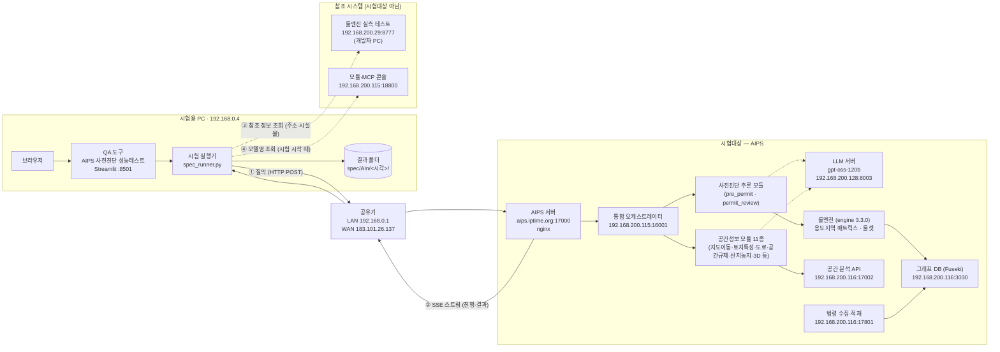
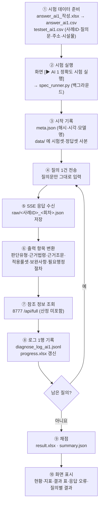

# AIPS 사전진단 성능테스트 — 시스템 아키텍처와 처리 프로세스

AI 통합인허가 사전진단 서비스(AIPS)의 성과지표 시험 환경을 정리한 문서입니다. 범위는 시험용 PC와 QA 도구부터 AI 판단 엔진, 참조 시스템까지입니다.

- 최종 갱신: 2026-11-04 (시험용 PC에서 직접 측정·조회한 값 기준)
- 이전 판: 2026-11-02 (네트워크 구간만)
- 표기
  - `확인 필요`: 시험용 PC에서 측정할 수 없어 담당자 확인이 필요한 항목
  - `조회값`: 개발·운영 사이트 화면이나 조회 API로 확인한 값 (시스템 응답 값이 아님)

---

## 1. 전체 구성도



| 선 | 의미 |
|---|---|
| 실선 ①② | 시험 질의와 응답. **이 경로만 성과지표 산정에 쓰입니다** |
| 점선 ③④ | 참고 정보 조회. 산정에는 쓰지 않고, 결과 화면에 참고로만 표시합니다 |

### 시험용 PC ↔ AIPS 서버 네트워크 구간

```
  ┌───────────────────┐  TCP/IP   ┌───────────────────┐  TCP/IP (HTTP)  ┌ ─ ─ ─ ─ ─ ─ ─ ─ ─ ─ ─ ─ ┐
  │    시험용 PC       │ ────────▶ │      공유기        │ ──────────────▶ │       AIPS 서버          │
  │  192.168.0.4      │           │ LAN 192.168.0.1   │                 │  aips.iptime.org:17000   │
  │  (Wi-Fi)          │ ◀──────── │ WAN 183.101.26.137│ ◀────────────── │  nginx                   │
  └───────────────────┘ 판정·근거  └───────────────────┘   SSE 스트림     └ ─ ─ ─ ─ ─ ─ ─ ─ ─ ─ ─ ─ ┘
                                                                         범례: ┌ ─ ─ ┐ 시험대상
```

시험용 PC와 AIPS 서버의 공인 IP가 같습니다(183.101.26.137). 그래서 서버는 같은 공유기 뒤에 있고 포트 17000이 포트 포워딩된 구조로 추정됩니다. 공유기 설정으로 확인해야 합니다.

---

## 2. 구성 요소

### 2-1. 시험대상 (AIPS)

| 구성 요소 | 주소 | 역할 | 확인 근거 |
|---|---|---|---|
| AIPS 서버 | `aips.iptime.org:17000` | 채팅 API 수신, SSE 응답 | 질의 응답 (`orc.start`의 build·contract_version) |
| AIPS 운영 서버 BE | `192.168.200.115:17001` | 채팅 세션·메시지 관리 API (Swagger) | 개발 사이트 조사표 16번 |
| 통합 오케스트레이터 | `192.168.200.115:16001` | 질의 해석 → 모듈 라우팅 → 결과 통합. 도구: `pre_permit`, `land_characteristics`, `map_control`, `map3d_analysis`, `law_text`, `screen_focus` | `GET /api/health` 조회값 |
| 사전진단 추론 모듈 | 오케스트레이터 내부 | 필지 분석(`permit_parcel`) → 인허가 판단(`permit_review`) | 응답의 진행 메시지 |
| 공간정보 모듈 11종 | `192.168.200.115` (컨테이너) | 위치검색·지도이동, 토지특성, 도로 접근성(접도), 공간규제, 산지·농지 규제, 3D 등 | 모듈 콘솔 `GET /api/stack` 조회값 |
| LLM 서버 | `192.168.200.128:8003` | **gpt-oss-120b** (2026-09-14 전환) | 모듈 콘솔 `GET /api/models` 조회값 |
| 룰엔진 | AIPS 내부 | 용도지역 매트릭스, 룰셋(접도·이격·경사·면적·심의 등). **engine_version 3.3.0** | 응답 `raw.engine.engine_version` |
| 공간 분석 API | `192.168.200.116:17002` | 필지·건축물 공간 분석, 토지이음(토지이용계획·토지대장) 조회 | Swagger (조사표 17번) |
| 법령 수집·적재 | `192.168.200.116:17801` | 법제처 법령·조례·행정규칙 수집. 법령 295, 문서 6,833, 조문 165,931, **마지막 수집 2026-10-18** | `GET /api/stats` 조회값 |
| 그래프 DB (Fuseki) | `192.168.200.116:3030` | 법령-조문-별표, 건축물 용도 관계 그래프 (dataset `nipa`) | 조사표 3번 |

### 2-2. 시험 도구 (QA 도구, 시험용 PC)

| 구성 요소 | 파일 | 역할 |
|---|---|---|
| 화면 | `qa_app.py` | Streamlit 앱 `http://localhost:8501`. 사이드바·진행 상태·공통 스타일·페이지 전환 |
| 성과지표 화면 | `spec_page.py` | AI1~AI7 현황, 시험 데이터 업로드, 실행, 결과 표·질의별 상세. 표 출력 공통 함수 `show_table` |
| 시험 실행기 | `spec_runner.py` | 시험셋 질의를 AIPS에 보내고 로그·결과 저장. 이어서 실행(`--resume`), 다시 채점(`--rescore`) |
| 채점 로직 | `spec_eval.py` | 응답 → 출력 항목 변환, 지표별 채점, 응답 오류 판별, 버전 정보, 참조 정보 조회 |
| 질의 전송 | `qa_runner.py` | SSE 스트림 질의 `stream_query()`, 응답 요약 `extract()` |
| 판단 여부 점검 | `check_page.py`, `verdict_check.py` | 질의별로 판단을 냈는지(판단 못함 여부) 점검 |

### 2-3. 참조 시스템 (시험대상 아님)

| 구성 요소 | 주소 | 쓰는 곳 | 비고 |
|---|---|---|---|
| 룰엔진 실측 테스트 | `192.168.200.29:8777` `POST /api/full` | AI1 결과의 `참조_PNU·용도지역·규제구역·토지특성·룰엔진판정` | **개발자 개인 PC**. 꺼져 있으면 `참조_조회오류`에 기록하고 시험은 계속 |
| 모듈·MCP 콘솔 | `192.168.200.115:18800` `GET /api/models` | 버전 정보의 "AI 사전진단 엔진 모델 버전" | 응답에 모델명이 없어서 시험 시작 때 조회. 실패하면 기본값 `gpt-oss-120b` |

---

## 3. 시험 처리 프로세스

### 3-1. 전체 흐름 (AI1 기준)



| 단계 | 내용 | 산출물 |
|---|---|---|
| ① 데이터 준비 | 작성용 엑셀의 [입력] 시트에 정답을 적고 [answer_ai1] 시트를 CSV UTF-8로 저장해 업로드. 시험셋은 4개 컬럼 | `spec_data/testset_ai1.csv`, `answer_ai1.csv` |
| ② 실행 | 실행할 ID를 비우면 전체. 백그라운드로 돌아 브라우저를 닫아도 계속 | `run_status.json` (진행 상태) |
| ③ 시작 기록 | 시험셋·정답셋 SHA-256, 시작 시각, 모델명(콘솔 조회) 기록. 데이터 **사본**을 실행 폴더에 저장 | `meta.json`, `data/` |
| ④ 질의 | `POST /api/chat/sessions/{세션ID}/messages/stream`, 본문 `user_request` = 질의문, 헤더 `X-Device-Id: qa-runner` | – |
| ⑤ 응답 | SSE 이벤트 수십 개를 받은 순서대로 저장 (3-2 참고) | `raw/AI1-0001_1.json` |
| ⑥ 변환 | 최종 진단(`diagnosis`)과 단계 결과에서 출력 항목 추출. 판정 없이 끝나면 오류 "응답 중단" | 로그 필드 |
| ⑦ 참조 | 주소·시설물로 룰엔진 조회. 실패해도 시험은 계속 | `참조_*` 필드 |
| ⑧ 기록 | 질의 1건당 1행 | `diagnose_log_ai1.jsonl`, `progress.xlsx` |
| ⑨ 채점 | 정답셋과 비교해 정확도·판단 유형별 결과·보조 지표·응답 오류·버전 정보 산출 | `result.xlsx`, `summary.json` |
| ⑩ 표시 | 화면은 **실행 폴더의 사본(`data/`)으로 다시 채점**. 나중에 정답셋을 바꿔도 지난 실행 점수는 그대로 | – |

### 3-2. AIPS 응답(SSE) 순서 — 실제 예 (AI1-0001, 이벤트 28개)

| 번호 | 이벤트 | 내용 |
|---|---|---|
| 0 | `orc.start` | 시작. build `3d415b4`, contract_version `2026-11-03` |
| 1~13 | `orc.trace` (+ 2번 `intent`) | 질의 해석 → 위치 찾기 → 토지대장·토지이용계획·공시지가 조회 → 면적·**접도 길이**·경사도·산지 규제 분석 |
| 14 | `orc.response` `parcel` | 필지 조회 결과 묶음 (도구 호출 결과 `envelopes`) |
| 15~22 | `orc.response` `stage` | 용도지역 및 토지이용계획 검토 대기 → 진행 → 완료 / 개발행위허가 검토 대기 → 진행 → **완료(판정)** |
| 23 | `orc.trace` | "검토 결과를 바탕으로 설명을 쓰고 있습니다" |
| 24~25 | `orc.response` `stage` | 단계 결과 최종본 |
| 26 | `orc.response` `diagnosis` | **최종 진단**. QA가 판단유형·근거조문 등을 뽑는 조각 |
| 27 | `orc.end` | 종료. trace_id, `sub_status` (`spatial`, `permit_review`) |

- 허가 **가능**이면 `building_permit`(건축허가), `civil_procedure`(인허가 절차 안내) 단계가 더 붙습니다. 보완사항과 필요 행정절차는 이 단계에서 나옵니다.
- 허가 **불가**이면 개발행위허가 검토에서 멈춥니다. 그래서 보완사항·필요 행정절차가 없습니다.

### 3-3. 출력 항목과 원천

| 출력 항목 | 원천 (응답) |
|---|---|
| 판단 유형 (2종) | `diagnosis.judgment.verdict` → 허가 가능 / 허가 불가능 |
| 근거 법령 · 근거 조문 | 판단을 좌우한 조문 → `법령ID.조.항` 정규화 (호·목 제외) |
| 적용 룰셋 | 조건 룰 `rule_id` + `MATRIX:용도지역코드:시설코드` + `OVERLAY:…` |
| 보완사항 | `diagnosis.recommendations[].question` |
| 필요 행정절차 | 필요 허가 + `civil_procedure` 단계의 절차 목록 |
| 버전 정보 | build·contract_version (`orc.start`), 룰엔진 버전 (`raw.engine.engine_version`), 공간정보 기준일 (`stdVer`), 모델명 (콘솔 조회값) |

### 3-4. 응답 오류 처리

| 종류 | 판별 | 화면 표시 | 다시 질의 |
|---|---|---|---|
| 연결 끊김 / 시간 초과 / 서버 오류 | 질의 중 예외 발생 | 오류 종류 + "질의 전송 직후" | "이어서 실행" 때 자동 |
| 응답 중단 | 최종 진단 없이 스트림 종료 | 오류 종류 + **끊긴 단계·마지막 진행 메시지** (`raw`에서 찾음) | "이어서 실행" 때 자동 |

- 응답 오류는 '판단불가'로 처리되어 오답으로 집계됩니다.
- 오류가 있을 때만 다음이 표시됩니다: 위쪽 지표의 "응답 오류", 혼동행렬의 "오류원인", 판단 유형별 결과의 "불일치(응답 오류)", 결과 영역의 "응답 오류 (N건)" 표, 질의별 결과의 "응답 오류" 칸.

### 3-5. 결과 폴더 구조

```
spec/AI1/20261103_164010/
├─ meta.json                 시작 시각, 대상 주소, 시험셋·정답셋 경로와 SHA-256, 모델명
├─ data/                     실행 당시 testset_ai1.csv · answer_ai1.csv 사본 (채점 기준)
├─ raw/AI1-0001_1.json …     질의별 SSE 응답 원문
├─ diagnose_log_ai1.jsonl    질의 1건당 1행 로그 (규격서 로그 파일)
├─ progress.xlsx             진행표 (판단유형·근거법령·근거조문·적용룰셋·소요초·오류)
├─ result.xlsx               결과·혼동행렬·판단 유형별 결과·응답 오류·보조 지표·버전 정보·사례별
└─ summary.json              결과 요약 (현황 표에 사용)
```

---

## 4. 측정 결과

| 항목 | 값 | 측정일 |
|---|---|---|
| 시험용 PC → 공유기 → 서버 경로 | 2홉 (`192.168.0.1` → `183.101.26.137`) | 11-02 |
| 시험용 PC 공인 IP | `183.101.26.137` (서버와 같음) | 11-02 |
| 응답 형식 | HTTP 200, `text/event-stream` | 11-02 |
| 질의 1건 소요 | 33~133초 (50건 평균 74초, 응답 오류 제외) | 11-03 |
| 질의 1건 SSE 이벤트 수 | 약 22~33개 | 11-03 |
| 시스템 빌드 | `8ae2627` (11-02) → `071ca19` → `e0828cd` → `3d415b4` (11-03, 하루 3회 변경) | 11-03 |
| contract_version | `2026-10-30` (11-02) → `2026-11-03` | 11-03 |
| 룰엔진 버전 | 3.3.0 | 11-03 |
| 공간정보 기준일 (stdVer) | 2026-04-24 | 11-03 |
| LLM | gpt-oss-120b (콘솔 조회값) | 11-04 |
| 법령 DB 마지막 수집 | 2026-10-18 (조회값) | 11-04 |
| AI1 50건 결과 | 정확도 84.00% (42/50). 응답 오류 3건(응답 중단 2, 연결 끊김 1) | 11-03 |

---

## 5. 확인 필요 항목

| 항목 | 현재 상태 | 확인·요청 |
|---|---|---|
| AI 엔진 모델 버전 | 응답에 없음. 콘솔 조회값(gpt-oss-120b)으로 표시. 사전진단 모듈도 같은 모델인지는 미확인 | `orc.start`에 모델명 추가 요청 (오케스트레이터 담당) |
| 법령·조례 DB 버전 | 응답에 없음. 화면에 "–" 표시 | `orc.start`에 법령 DB 기준일 추가 요청 |
| 룰셋 버전 | 룰엔진 버전(3.3.0)으로 대신 표시. 룰셋 자체 버전 없음. 룰 출처가 여러 날짜로 섞여 있음 (Fuseki v109, 법제처 10-29·10-30 대조 등) | 룰셋 버전 필드 추가와 시험 기간 동결 요청 |
| 시험 기간 빌드 고정 | 11-03 하루에 3회 변경. 응답 중단·연결 끊김이 재배포 시점과 겹침 | 시험 기간 배포 중지 요청 |
| temperature = 0 적용 | 응답으로 확인 불가 | 개발팀 확인 |
| 접도 계산 (수치지형도 vs 지적도) | 도로 면이 필지를 덮으면(`roadOccupied`) 접도 0m로 계산. 반대로 현황 도로를 접도로 인정하는 경우도 있음 | AIPS·룰엔진 개발팀 보완 요청 |
| AIPS 서버 내부 IP·포트 포워딩·호스팅 | 측정 불가 | 공유기 설정 또는 서버 담당자 확인 |
| QA 도구 실행 위치 | 시험의뢰서는 **APP Server**의 QA 웹 UI(8501)인데, 현재는 시험용 PC에서 실행 | APP Server에 배포 |

관련 문서
- 변경 내역: [CHANGELOG_20261103.md](CHANGELOG_20261103.md)
- 산정식 검토: [산정식_검토사항.md](산정식_검토사항.md)
- 사용 설명: [README_QA.md](README_QA.md)
