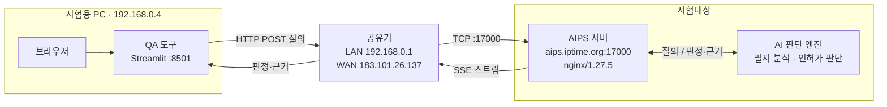

# AIPS 사전진단 시스템 구성도 (End-to-End)

AI 통합인허가 사전진단 서비스의 시험 환경을 시험용 PC부터 AI 판단 엔진까지 정리한 문서입니다.

- 기준일: 2026-11-02 (시험용 PC에서 직접 측정)
- 표기: `확인 필요`는 PC에서 측정할 수 없어 시스템 담당자의 확인이 필요한 항목입니다.

## 1. 시스템 구성도

```
                           텍스트 데이터 (질의)                   텍스트 데이터 (질의)
      ┌───────────────────┐ ─ ─ ─ ─ ─ ─ ─ ▶ ┌──────────────────┐ ─ ─ ─ ─ ─ ─ ─ ▶ ┌ ─ ─ ─ ─ ─ ─ ─ ─ ─ ─ ─ ─ ┐
      │    시험용 PC       │    TCP/IP       │      공유기       │    TCP/IP       │        AIPS 서버          │
      │                   │                 │                  │    (HTTP)       │                           │
      │  192.168.0.4      │                 │ LAN 192.168.0.1  │                 │  aips.iptime.org:17000    │
      │  (Wi-Fi)          │                 │ WAN 183.101.26.137│                │  nginx/1.27.5             │
      │                   │ ◀ ─ ─ ─ ─ ─ ─ ─ │                  │ ◀ ─ ─ ─ ─ ─ ─ ─ │  내부 IP: 확인 필요        │
      └───────────────────┘   판정·근거      └──────────────────┘   SSE 스트림     └ ─ ─ ─ ─ ─ ┬ ─ ─ ─ ─ ─ ─ ─ ┘
                                                                                            │  ▲
                                                                                 질의 전달   │  │  판정·근거
                                                                                            ▼  │
                                                                               ┌ ─ ─ ─ ─ ─ ─ ─ ─ ─ ─ ─ ─ ┐
                                                                                     AI 판단 엔진
                                                                               │  필지 분석 · 인허가 판단   │
                                                                                     룰셋 · 법령/조례 DB
                                                                               └ ─ ─ ─ ─ ─ ─ ─ ─ ─ ─ ─ ─ ┘

      범례:  ┌ ─ ─ ┐ 시험대상     ─ ─ ▶ 데이터 이동
```



## 2. 구성 요소

| 구분 | 구성 요소 | 주소 | 역할 | 시험대상 |
|---|---|---|---|---|
| 시험 환경 | 시험용 PC | `192.168.0.4` (Wi-Fi) | QA 도구 실행, 질의 전송, 결과 저장·채점 | 아니요 |
| 시험 환경 | QA 도구 | `http://localhost:8501` | 시험 화면(Streamlit), 일괄 질의 | 아니요 |
| 네트워크 | 공유기 | LAN `192.168.0.1` / WAN `183.101.26.137` | 사내망과 인터넷 연결, NAT | 아니요 |
| 시스템 | AIPS 서버 | `aips.iptime.org` → `183.101.26.137:17000` | 웹 서비스, API 수신, SSE 응답 | 예 |
| 시스템 | AI 판단 엔진 | 확인 필요 | 필지 분석, 규제 조회, 인허가 판단 | 예 |

## 3. End-to-End 처리 흐름

| 단계 | 구간 | 내용 |
|---|---|---|
| 1 | 시험원 → QA 도구 | 브라우저로 `http://localhost:8501`에 접속해 시험 실행 |
| 2 | QA 도구 → 공유기 | `POST /api/chat/sessions/{세션ID}/messages/stream` 전송 (본문 `user_request`, 헤더 `X-Device-Id: qa-runner`) |
| 3 | 공유기 → AIPS 서버 | `183.101.26.137:17000`으로 전달 |
| 4 | AIPS 서버 → AI 판단 엔진 | `route_to_sub`가 질의를 분류해 사전진단 에이전트로 전달 |
| 5 | AI 판단 엔진 내부 | `permit_parcel`(필지 분석) → `permit_review`(인허가 판단) 수행 |
| 6 | AIPS 서버 → QA 도구 | SSE로 진행 상황과 결과를 순서대로 전송 |
| 7 | QA 도구 → 시험용 PC | 응답 원문과 채점 결과를 `dashboard/`, `spec/`, `check/`에 저장 |

### SSE 응답 순서

| 순서 | 이벤트 | 내용 |
|---|---|---|
| 1 | `orc.start` | 세션 ID, 빌드, 계약 버전 |
| 2 | `orc.trace` | 처리 단계별 진행 메시지 |
| 3 | `orc.response` | 의도(`intent`), 필지(`parcel`), 단계 결과(`stage`), 최종 진단(`diagnosis`) |
| 4 | `orc.end` | 추적 ID, 하위 처리 상태(`sub_status`) |

### AI 판단 엔진이 호출하는 도구

응답에서 확인한 도구입니다.

| 분류 | 도구 |
|---|---|
| 위치·필지 | `locationSearch`, `parcelInfo`, `mapFeature` |
| 공간·규제 | `tool.spatial.analysis`, `tool.land.regulation` |
| 지형·접도 | `tool.map3d.slope`, `tool.road.contact` |

## 4. 측정 결과

| 항목 | 값 |
|---|---|
| 시험용 PC → 공유기 → 서버 경로 | 2홉 (`192.168.0.1` → `183.101.26.137`) |
| 시험용 PC 공인 IP | `183.101.26.137` (서버 IP와 같음) |
| 질의 1건 응답 코드 | HTTP 200, `text/event-stream` |
| 질의 1건 첫 응답 / 전체 소요 | 0.05초 / 139.6초 |
| 하위 처리 상태 | `spatial: OK`, `permit_review: OK` |
| 시스템 빌드 | `8ae2627` |
| 계약 버전 | `2026-10-30` |

시험용 PC와 서버의 공인 IP가 같으므로, 서버는 같은 공유기에 연결되어 있고 포트 17000이 포트 포워딩된 구조로 추정됩니다. 공유기 설정으로 확인해야 합니다.

## 5. 확인 필요 항목

| 항목 | 현재 상태 | 확인 방법 |
|---|---|---|
| AIPS 서버 내부 IP, 포트 포워딩 | 측정 불가 | 공유기 관리 화면 또는 서버 담당자 확인 |
| 서버 호스팅 형태, OS, 사양 | 측정 불가 | 서버 담당자 확인 |
| 웹 서비스 버전 | 응답에 없음. 빌드 값으로 대체 | 시스템 담당자 확인 |
| AI 엔진 모델 버전, 룰셋 버전, 법령·조례 DB 버전 | 응답에 없음 | `orc.start`에 값 추가 요청 (README 9-7) |
| 사용 LLM, 외부 서비스 연동 여부 | 측정 불가 | 시스템 담당자 확인 |
| AI 판단 엔진 실행 위치 | 측정 불가 | 시스템 담당자 확인 |
