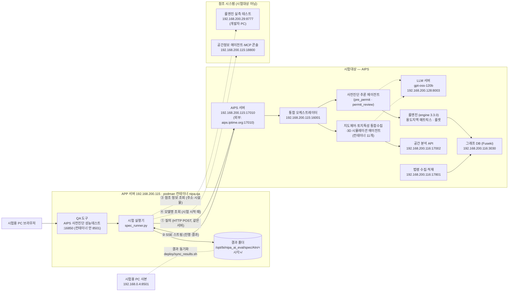
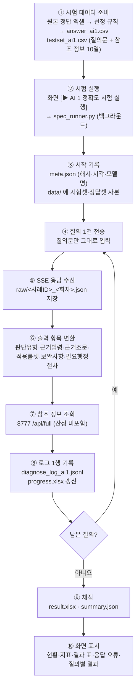

# AIPS 사전진단 성능테스트 — 시스템 아키텍처와 처리 프로세스

AI 통합인허가 사전진단 서비스(AIPS)의 성과지표 시험 환경을 정리한 문서입니다. 범위는 시험용 PC와 QA 도구부터 AI 판단 엔진, 참조 시스템까지입니다.

- 최종 갱신: 2026-11-10 (AI5 결과, 산정식 표기 방침 반영). 이전 11-09: QA 도구를 APP 서버로 옮기고(podman, 16850), 규격서 v1.51 기준으로 시험 데이터와 AI3 6단계를 바꾼 내용을 반영했습니다.
- 이전 판
  - 2026-11-04: 시험용 PC 기준
  - 2026-11-02: 네트워크 구간만
- 기준 문서: 의뢰자제시기준규격서 v1.51 (2026-11-09, `참고문서/`)
- 표기
  - `확인 필요`: 시험용 PC에서 측정할 수 없어 담당자 확인이 필요한 항목
  - `조회값`: 개발·운영 사이트 화면이나 조회 API로 확인한 값 (시스템 응답 값이 아님)

---

## 1. 전체 구성도



| 선 | 의미 |
|---|---|
| 실선 ①② | 시험 질의와 응답. **이 경로만 성과지표 산정에 쓰입니다** |
| 점선 ③④ | 참고 정보 조회. 산정에는 쓰지 않고, 결과 화면에 참고로만 표시합니다 |

### (참고) 이관 전: 시험용 PC ↔ AIPS 서버 네트워크 구간

2026-11-09 이후 시험은 APP 서버의 QA 도구가 같은 서버의 AIPS(`192.168.200.115:17010`, 2026-11-10 17000에서 변경)로 질의합니다. 아래 구간은 이관 전 시험용 PC에서 시험하던 때의 경로입니다.

```
  ┌───────────────────┐  TCP/IP   ┌───────────────────┐  TCP/IP (HTTP)  ┌ ─ ─ ─ ─ ─ ─ ─ ─ ─ ─ ─ ─ ┐
  │    시험용 PC       │ ────────▶ │      공유기        │ ──────────────▶ │       AIPS 서버          │
  │  192.168.0.4      │           │ LAN 192.168.0.1   │                 │  aips.iptime.org:17000   │
  │  (Wi-Fi)          │ ◀──────── │ WAN 183.101.26.137│ ◀────────────── │  nginx                   │
  └───────────────────┘ 판정·근거  └───────────────────┘   SSE 스트림     └ ─ ─ ─ ─ ─ ─ ─ ─ ─ ─ ─ ─ ┘
                                                                         범례: ┌ ─ ─ ┐ 시험대상
```

시험용 PC와 AIPS 서버의 공인 IP가 같습니다(183.101.26.137). 그래서 서버는 같은 공유기 뒤에 있고 포트 17000이 포트 포워딩된 구조로 추정됩니다. 공유기 설정으로 확인해야 합니다.

---

## 2. 구성 요소

### 2-1. 시험대상 (AIPS)

| 구성 요소 | 주소 | 역할 | 확인 근거 |
|---|---|---|---|
| AIPS 서버 | `192.168.200.115:17010` (2026-11-10 변경, 이전 17000. 외부 `aips.iptime.org:17010`) | 채팅 API 수신, SSE 응답 | 질의 응답 (`orc.start`의 build·contract_version) |
| AIPS 운영 서버 BE | `192.168.200.115:17001` | 채팅 세션·메시지 관리 API (Swagger) | 개발 사이트 조사표 16번 |
| 통합 오케스트레이터 | `192.168.200.115:16001` | 질의 해석 → 에이전트 라우팅 → 결과 통합. 도구: `pre_permit`, `land_characteristics`, `map_control`, `map3d_analysis`, `law_text`, `screen_focus` | `GET /api/health` 조회값 |
| 사전진단 추론 에이전트 | 통합 오케스트레이터 내부 | 필지 분석(`permit_parcel`) → 인허가 판단(`permit_review`) | 응답의 진행 메시지 |
| 지도제어·토지특성 통합수집·3D 시뮬레이션 에이전트 (컨테이너 11개) | `192.168.200.115` (컨테이너) | 지도제어: 위치 식별·필지 선택·면적 산출·레이어 제어 / 토지특성 통합수집: 필지 정보·접도 조건·인접 도로·규제 정보 수집 / 3D 시뮬레이션: 경사도 산출. (공간분석 Vision 에이전트의 영상 분석은 응답에 나타나지 않음) | 에이전트·MCP 콘솔 `GET /api/stack` 조회값 |
| LLM 서버 | `192.168.200.128:8003` | **gpt-oss-120b** (2026-09-14 전환) | 에이전트·MCP 콘솔 `GET /api/models` 조회값 |
| 룰엔진 | AIPS 내부 | 용도지역 매트릭스, 룰셋(접도·이격·경사·면적·심의 등). **engine_version 3.3.0** | 응답 `raw.engine.engine_version` |
| 공간 분석 API | `192.168.200.116:17002` | 필지·건축물 공간 분석, 토지이음(토지이용계획·토지대장) 조회 | Swagger (조사표 17번) |
| 법령 수집·적재 | `192.168.200.116:17801` | 법제처 법령·조례·행정규칙 수집. 법령 295, 문서 6,833, 조문 165,931, **마지막 수집 2026-10-18** | `GET /api/stats` 조회값 |
| 그래프 DB (Fuseki) | `192.168.200.116:3030` | 법령-조문-별표, 건축물 용도 관계 그래프 (dataset `nipa`) | 조사표 3번 |

### 2-2. 시험 도구 (QA 도구, APP 서버 컨테이너)

| 구성 요소 | 파일 | 역할 |
|---|---|---|
| 화면 | `qa_app.py` | Streamlit 앱 **`http://192.168.200.115:16850`**(APP 서버, 운영). 시험용 PC 사본 `http://192.168.0.4:8501`. 사이드바·진행 상태·공통 스타일·페이지 전환 |
| 성과지표 화면 | `spec_page.py` | AI1~AI7 현황, 시험 데이터 업로드, 실행, 결과 표·질의별 상세. 표 출력 공통 함수 `show_table` |
| 시험 실행기 | `spec_runner.py` | 시험셋 질의를 AIPS에 보내고 로그·결과 저장. 이어서 실행(`--resume`), 다시 채점(`--rescore`) |
| 채점 로직 | `spec_eval.py` | 응답 → 출력 항목 변환, 지표별 채점, 응답 오류 판별, 버전 정보, 참조 정보 조회 |
| 질의 전송 | `qa_runner.py` | SSE 스트림 질의 `stream_query()`, 응답 요약 `extract()` |
| 판단 여부 점검 | `check_page.py`, `verdict_check.py` | 질의별로 판단을 냈는지(판단 못함 여부) 점검 |
| 배포 | `deploy/Containerfile`, `deploy/nipa-qa.container`, `deploy/requirements-lock.txt`, `deploy/sync_results.sh` | 이미지(Python 3.12, PC와 같은 패키지 버전), systemd Quadlet 상시 실행, PC↔서버 결과 동기화. 절차는 `deploy/README_배포.md` |
| 설정 (환경변수) | `AIPS_BASE`, `AIPS_REF_BASE` | 서버·PC 기본값: `http://192.168.200.115:17010/api`, `http://192.168.200.29:8777`. 지정하지 않으면 PC 기본값 |

### 2-3. 참조 시스템 (시험대상 아님)

| 구성 요소 | 주소 | 쓰는 곳 | 비고 |
|---|---|---|---|
| 룰엔진 실측 테스트 | `192.168.200.29:8777` `POST /api/full` | AI1 결과의 `참조_PNU·용도지역·규제구역·토지특성·룰엔진판정` | **개발자 개인 PC**. 꺼져 있으면 `참조_조회오류`에 기록하고 시험은 계속 |
| 공간정보 에이전트·MCP 콘솔 | `192.168.200.115:18800` `GET /api/models` | 버전 정보의 "AI 사전진단 엔진 모델 버전" | 응답에 모델명이 없어서 시험 시작 때 조회. 실패하면 기본값 `gpt-oss-120b` |

### 2-4. 서버·인프라 (설치정보 v1.1 + 서버 배정 안내, 2026-11-04 확인)

| 서버 | 주소 · OS | 설치 제품 | 버전 | 포트 | 시험용 PC에서 확인 |
|---|---|---|---|---|---|
| LLM | `192.168.200.128` | gpt-oss-120b (vLLM, 도커) | vLLM **0.24.0** | 8003 | ✅ 접속, `GET /version` → 0.24.0 |
| **APP 서버** | `192.168.200.115` · Ubuntu 24.04.4 | python3, podman | 3.12.3, 4.9.3 | – | ✅ 접속 (ssh 22) |
| **DB 서버** | `192.168.200.116` · Rocky 10.2 | Apache Jena **Fuseki** (그래프 DB) | **6.1.0** | 3030 | ✅ 접속, `GET /$/server` → 6.1.0 |
| | **Milvus** (벡터 DB) | **2.6.18** | 19530 (상태 9091) | ✅ 19530 접속 (9091은 응답 없음) |
| | Milvus etcd / MinIO | 3.5.25 / 2024-05-28 | 2379-2380 / 9001 | etcd 응답 없음 (내부용으로 보임) / MinIO ✅ |
| | Redis | 7.4.10 | 6379 | ✅ 접속 |
| | podman | 5.8.2 | – | – |
| | **PostgreSQL · PostGIS** (공간 DB `ipss`, 239 GB) | **18.6 · 3.6.4** | 17432 | 토지특성 공간 DB 명세(2026-10-19) 기준. 접속은 확인 안 함 |
| | 법령 수집·적재 관리자 | – | 17801 | ✅ `GET /api/stats` (로그인 없이). 작업 이력은 로그인 필요 |

- 설치정보 v1.1 엑셀은 DB 서버를 `192.168.200.19`(RDB), APP 서버를 `192.168.200.21`로 적었습니다. 하지만 이 주소로는 접속되지 않았고, 같은 제품이 **DB 서버 192.168.200.116**에서 동작합니다. 서버 배정 안내 주소(APP .115, DB .116)가 맞습니다.
- **관계형 DB는 설치정보에 없지만, 공간 DB 명세에서 확인했습니다.** DB 서버 116의 17432 포트에서 PostgreSQL 18.6 + PostGIS 3.6.4(`ipss`)가 동작합니다. 연속지적도, 용도지역·지구 연속주제도(법령 169개·조례 24개 레이어), 토지대장 등이 들어 있습니다. 법령 DB(수집·적재 관리자의 저장소)가 같은 PostgreSQL인지는 개발팀 확인이 필요합니다.
- 계정·비밀번호는 이 문서에 적지 않습니다(설치정보 원본 참고).

**참여사별 배정 포트·배포 위치** (서버 배정 안내)

| 참여사 | 포트 범위 | 배포 위치 | 확인된 서비스 |
|---|---|---|---|
| BI (비아이매트릭스) | 16000~16999 | `/opt/bi` | 주간실적 보고 `115:16000`, 통합 오케스트레이터 `115:16001`, 통합오케 참조 UI `115:16002`, Fuseki 노드탐색 `115:16500`, **QA 도구 `115:16850` (`/opt/bi/nipa_ai_eval`, 2026-11-09)** |
| WAVUS (웨이버스) | 17000~17999 | `/opt/wavus` | AIPS 운영 서버 `115:17001`, 공간 분석 API `116:17002`, 법령 수집·적재 `116:17801` |
| ICT (아이씨티웨이) | 18000~18999 | `/opt/ict` | 공간정보 에이전트·MCP 콘솔 `115:18800` (조사표상 담당은 웨이버스 → 확인 필요) |

---

## 3. 시험 처리 프로세스

### 3-1. 전체 흐름 (AI1 기준)



| 단계 | 내용 | 산출물 |
|---|---|---|
| ① 데이터 준비 | 5개 지자체 원본 정답 엑셀에서 정해진 규칙으로 선정합니다(3-6 참고). 시험셋은 10개 열(질의문 + 규격서 참조 정보)이고, AIPS에는 질의문만 입력합니다 | `spec_data/testset_ai1.csv`, `answer_ai1.csv`, `원본_5개지자체/AI1_50건_선정내역_v151.xlsx` |
| ② 실행 | 실행할 ID를 비우면 전체. 백그라운드로 돌아 브라우저를 닫아도 계속 | `run_status.json` (진행 상태) |
| ③ 시작 기록 | 시험셋·정답셋 SHA-256, 시작 시각, 모델명(콘솔 조회) 기록. 데이터 **사본**을 실행 폴더에 저장 | `meta.json`, `data/` |
| ④ 질의 | `POST /api/chat/sessions/{세션ID}/messages/stream`, 본문 `user_request` = 질의문, 헤더 `X-Device-Id: qa-runner` | – |
| ⑤ 응답 | SSE 이벤트 수십 개를 받은 순서대로 저장 (3-2 참고) | `raw/AI1-0001_1.json` |
| ⑥ 변환 | 최종 진단(`diagnosis`)과 단계 결과에서 출력 항목 추출. 판정 없이 끝나면 오류 "응답 중단" | 로그 필드 |
| ⑦ 참조 | 주소·시설물로 룰엔진 조회. 실패해도 시험은 계속 | `참조_*` 필드 |
| ⑧ 기록 | 질의 1건당 1행 | `diagnose_log_ai1.jsonl`, `progress.xlsx` |
| ⑨ 채점 | 정답셋과 비교해 정확도·판단 유형별 결과·보조 지표·응답 오류·버전 정보 산출. **실행 시작 때 복사한 사본(`data/`)으로 채점**합니다 | `result.xlsx`, `summary.json` |
| ⑩ 표시 | 화면은 **실행 폴더의 사본(`data/`)으로 다시 채점**. 나중에 정답셋을 바꿔도 지난 실행 점수는 그대로 | – |

### 3-2. AIPS 응답(SSE) 순서 — 실제 예 (AI1-0001, 이벤트 28개)

| 번호 | 이벤트 | 내용 |
|---|---|---|
| 0 | `orc.start` | 시작. build `3d415b4`, contract_version `2026-11-03` |
| 1~13 | `orc.trace` (+ 2번 `intent`) | 질의 해석 → 위치 찾기 → 토지대장·토지이용계획·공시지가 조회 → 면적·**접도 길이**·경사도·산지 규제 분석 |
| 14 | `orc.response` `parcel` | 필지 조회 결과 묶음 (도구 호출 결과 `envelopes`) |
| 15~22 | `orc.response` `stage` | 용도지역 및 토지이용계획 검토 대기 → 진행 → 완료 / 개발행위허가 검토 대기 → 진행 → **완료(판정)** |
| 23 | `orc.trace` | "검토 결과를 바탕으로 설명을 쓰고 있습니다" |
| 24~25 | `orc.response` `stage` | 단계 결과 최종본 |
| 26 | `orc.response` `diagnosis` | **최종 진단**. QA가 판단유형·근거조문 등을 뽑는 조각 |
| 27 | `orc.end` | 종료. trace_id, `sub_status` (`spatial`, `permit_review`) |

- 허가 **가능**이면 `building_permit`(건축허가), `civil_procedure`(인허가 절차 안내) 단계가 더 붙습니다. 보완사항과 필요 행정절차는 이 단계에서 나옵니다.
- 허가 **불가**이면 개발행위허가 검토에서 멈춥니다. 그래서 보완사항·필요 행정절차가 없습니다.

### 3-3. 출력 항목과 원천

| 출력 항목 | 원천 (응답) |
|---|---|
| 판단 유형 (2종) | `diagnosis.judgment.verdict` → 허가 가능 / 허가 불가능 |
| 근거 법령 · 근거 조문 | 판단을 좌우한 조문 → `법령ID.조.항` 정규화 (호·목 제외) |
| 적용 룰셋 | 조건 룰 `rule_id` + `MATRIX:용도지역코드:시설코드` + `OVERLAY:…` |
| 보완사항 | `diagnosis.recommendations[].question` |
| 필요 행정절차 | 필요 허가 + `civil_procedure` 단계의 절차 목록 |
| 버전 정보 | build·contract_version (`orc.start`), 룰엔진 버전 (`raw.engine.engine_version`), 용도지역·지구 표준분류 개정 기준일 (`stdVer`), 모델명 (콘솔 조회값), 법령 DB·법령해석사례 (수집 관리자 조회값) |

### 3-4. 응답 오류 처리

| 종류 | 판별 | 화면 표시 | 다시 질의 |
|---|---|---|---|
| 연결 끊김 / 시간 초과 / 서버 오류 | 질의 중 예외 발생 | 오류 종류 + "질의 전송 직후" | "이어서 실행" 때 자동 |
| 응답 중단 | 최종 진단 없이 스트림 종료 | 오류 종류 + **끊긴 단계·마지막 진행 메시지** (`raw`에서 찾음) | "이어서 실행" 때 자동 |

- 응답 오류는 '판단불가'로 처리되어 오답으로 집계됩니다.
- 오류가 있을 때만 다음이 표시됩니다: 위쪽 지표의 "응답 오류", 혼동행렬의 "오류원인", 판단 유형별 결과의 "불일치(응답 오류)", 결과 영역의 "응답 오류 (N건)" 표, 질의별 결과의 "응답 오류" 칸.

### 3-5. 결과 폴더 구조

```
spec/AI1/20261103_164010/
├─ meta.json                 시작 시각, 대상 주소, 시험셋·정답셋 경로와 SHA-256, 모델명
├─ data/                     실행 당시 testset_ai1.csv · answer_ai1.csv 사본 (채점 기준)
├─ raw/AI1-0001_1.json …     질의별 SSE 응답 원문
├─ diagnose_log_ai1.jsonl    질의 1건당 1행 로그 (규격서 로그 파일)
├─ progress.xlsx             진행표 (판단유형·근거법령·근거조문·적용룰셋·소요초·오류)
├─ result.xlsx               결과·혼동행렬·판단 유형별 결과·응답 오류·보조 지표·버전 정보·사례별
└─ summary.json              결과 요약 (현황 표에 사용)
```

### 3-6. 시험 데이터 구성 (규격서 v1.51, 2026-11-09)

| 항목 | 파일 | 구성 | 선정 기준 |
|---|---|---|---|
| AI1 | `testset_ai1.csv`, `answer_ai1.csv` | 50건, 허가 가능 25 / 불가능 25, 지자체 5곳 × 10건 | 아래 공통 규칙 |
| AI2 | `testset_ai2.csv`, `answer_ai2.csv` | 시나리오 10건(가능 5 / 불가능 5) × 원문 1 + 변형 4 = 50 질의 | 허가 가능은 접도까지 따진 빵공장 정답에서 우선 선정. 주소는 시·도까지만 생략 |
| AI3 | `testset_ai3.csv` (정답 없음) | 10건 × 5회 = 50회 | AI1 50건에서 지자체마다 가능 1·불가능 1 |
| AI5 | `testset_ai5.csv`, `answer_ai5.csv`, `law_article_db.csv` | 50건 + 정답 조문셋 + 법령·조례 조문 DB | AI1과 같은 규칙, AI1과 다른 필지 우선(4건만 겹침). 조문 DB는 법령 수집·적재 관리자 적재분에서 생성 |
| 판정 기준 | `판단유형_조작적정의서.xlsx` | 조건부 가능 = 허가 가능, 검토 필요 = 판정 없음(불일치) | 규격서 "조작적 정의서" |

**공통 규칙**
- 원본은 5개 지자체 정답 엑셀(단독주택·빵공장, 주소 329건)입니다.
- 시스템(AIPS) 판정 결과는 보지 않고 규칙으로만 선정합니다.
- 다음 후보는 제외합니다.
  - 근거 조문 없음
  - "가능"인데 도시계획시설이 걸림(국토계획법 §64①과 불일치)
  - "가능"인데 단서가 붙음
  - 단독주택 "가능"인데 맹지
  - 도로 면 30% 이상 겹침(접도 측정 불가, 시험기관 합의 범위)
- 정답 정정은 법령 근거를 확인한 5건만 했습니다(변경내역 8-1·8-2).

### 3-7. AI3 6단계 처리 로그 (규격서 v1.51)

① 질의 파싱 ② 대상 필지(PNU) 조회 ③ 토지특성(지목, 면적) 조회 ④ 적용 법령·조례 검색 ⑤ 룰셋 적용 ⑥ 최종 판단 도출. AIPS 응답(SSE)의 처리 기록으로 재구성하며, 기준은 [6단계_처리로그_추출기준.md](6단계_처리로그_추출기준.md)에 있습니다.

---

## 4. 측정 결과

| 항목 | 값 | 측정일 |
|---|---|---|
| 시험용 PC → 공유기 → 서버 경로 | 2홉 (`192.168.0.1` → `183.101.26.137`) | 11-02 |
| 시험용 PC 공인 IP | `183.101.26.137` (서버와 같음) | 11-02 |
| 응답 형식 | HTTP 200, `text/event-stream` | 11-02 |
| 질의 1건 소요 | 33~133초 (50건 평균 74초, 응답 오류 제외) | 11-03 |
| 질의 1건 SSE 이벤트 수 | 약 22~33개 | 11-03 |
| 시스템 빌드 | `8ae2627` (11-02) → `071ca19` → `e0828cd` → `3d415b4` (11-03, 하루 3회 변경) | 11-03 |
| contract_version | `2026-10-30` (11-02) → `2026-11-03` | 11-03 |
| 룰엔진 버전 | 3.3.0 | 11-03 |
| 용도지역·지구 표준분류 개정 기준일 (stdVer) | 2026-04-24 개정판. 공간 DB의 용도코드→지도 레이어 대응표(`land_use_zone_code`)가 이 개정판(`코드변경 및 추가(20260424).xls`)으로 적재됨 | 11-04 |
| LLM | gpt-oss-120b (콘솔 조회값) | 11-04 |
| 법령 DB 수집 이력 | 10-13 15:24~15:50 대량 수집(작업 15건), **10-18 13:08~13:10 마지막 수집**(20건 중 13건 신규·개정 반영: 재생에너지법 시행령·시행규칙 등). 이후 수집 없음 | 11-04 |
| 법령해석사례 | 8,912건, 매일 04:00 자동 증분 수집(마지막 11-04 04:00, 최신 회신 11-02) | 11-04 |
| 공간 DB 명세 작성일 | 2026-10-19 | 11-04 |
| 법령 온톨로지 (Fuseki `nipa`) | `owl:versionInfo` **4.2.0-grounding** ("PRODUCTION, 라이브 corpus 실증 2026-06-12"), 그래프 649개 · 트리플 1,408,044 | 11-04 |
| 룰엔진 실측 테스트 (참조) | 현황 엑셀에는 `192.168.200.7:8777`로 적혀 있으나 접속 안 됨. 실제 동작은 `192.168.200.29:8777` (build `db0c02c`, engine 3.3.0) | 11-04 |
| AI1 50건 결과 | 정확도 84.00% (42/50). 응답 오류 3건(응답 중단 2, 연결 끊김 1) | 11-03 |
| AI1 (규격서 v1.51 50건, `20261109_154733`) | **정확도 98.00%** (49/50) — 달성. 11-10 AI1-0017을 건기연 정답(가능)으로 원복해 재채점 | 11-10 |
| AI2 (`20261109_144933`) | **가중평균 F1 100.00%** — 달성 | 11-09 |
| AI3 (서버 실행, `20261109_164810`) | **일관성 100.00%** (50/50), 사례 단위 100%, 6단계 불일치 0건 — 달성. build `87866ef` | 11-09 |
| AI5 (서버 실행, `20261109_175511`) | **환각 발생률 92.00%** (46/50) — 미달성. ① 1(옛 법령명) · ② 4(근거 필드 빈칸) · ③ 25 · ④ 46. 원인과 조치는 `성과지표_규격기준_정리.md` 2-5 | 11-09 |
| AIPS 접속 주소 변경 | `192.168.200.115:17000` → **`:17010`** (11-10). 두 포트 모두 build `b880f1c`를 돌려줬고, 외부 `aips.iptime.org:17000`은 끊김. QA 서버·PC 모두 17010으로 질의 확인 | 11-10 |
| 시스템 빌드 변경 | `87866ef`(11-09 시험) → **`b880f1c`**(11-10) | 11-10 |
| QA 서버 이관 | APP 서버 `/opt/bi/nipa_ai_eval`, 16850. 이관한 결과 8개를 서버에서 다시 채점한 결과 PC와 모두 같음 | 11-09 |

---

## 5. 확인 필요 항목

| 항목 | 현재 상태 | 확인·요청 |
|---|---|---|
| AI 엔진 모델 버전 | 응답에 없음. 콘솔 조회값(gpt-oss-120b)으로 표시. 사전진단 추론 에이전트도 같은 모델인지는 미확인 | `orc.start`에 모델명 추가 요청 (오케스트레이터 담당) |
| 법령·조례 DB 버전 | 응답에 없음. 화면에 "–" 표시 | `orc.start`에 법령 DB 기준일 추가 요청 |
| 룰셋 버전 | 룰엔진 버전(3.3.0)으로 대신 표시. 룰셋 자체 버전 없음. 룰 출처가 여러 날짜로 섞여 있음 (Fuseki v109, 법제처 10-29·10-30 대조 등) | 룰셋 버전 필드 추가와 시험 기간 동결 요청 |
| 시험 기간 빌드 고정 | 11-03 하루에 3회 변경. 응답 중단·연결 끊김이 재배포 시점과 겹침 | 시험 기간 배포 중지 요청 |
| temperature = 0 적용 | 응답으로 확인 불가 | 개발팀 확인 |
| 접도 계산 (수치지형도 vs 지적도) | 도로 면이 필지를 덮으면(`roadOccupied`) 접도 0m로 계산. 반대로 현황 도로를 접도로 인정하는 경우도 있음 | AIPS·룰엔진 개발팀 보완 요청 |
| AIPS 서버 내부 IP·포트 포워딩·호스팅 | 측정 불가 | 공유기 설정 또는 서버 담당자 확인 |
| QA 도구 접속 주소 | **해결(11-09):** APP 서버 `http://192.168.200.115:16850`에 podman 컨테이너로 배포 | 규격서 시험방법 (1)의 `:8501`을 `http://192.168.200.115:16850`으로 고치도록 의뢰서 작성자에게 전달 |
| 접도 판정 결함 | 도로 면이 겹친 필지에서 접도를 측정하지 않고(값 없음) 판정 단계가 이를 0m로 처리해 허가 불가로 판정 | 개발팀 보완 요청서 전달(`개발팀_보완요청_접도판정_20261109.xlsx`). 시험 범위는 시험기관 합의로 제외 → **합의 문서 보관 필요** |
| AI5 환각 ④ 판정 | 규격서대로 적용 법령 집합 완전 일치로 판정. 시스템은 함께 검토한 법령(가축분뇨법 등)을 더 인용하는 경향이 있음 | 결과를 보고 조작적 정의서 보완 여부 결정 |
| 관계형 DB | 공간 DB는 116:17432 PostgreSQL 18.6·PostGIS 3.6.4로 확인(명세 기준). 설치정보 v1.1에는 없음 | 법령 DB도 같은 PostgreSQL인지, 설치정보에 추가할지 개발팀 확인 |
| 법령해석사례 매일 갱신 | 매일 04시 자동 수집이라 시험 기간에도 바뀜 | 시험 기간 동결 대상인지(스케줄 중지 여부) 시험기관·개발팀과 협의 |
| 지도 도형 기준일 | 응답의 stdVer는 표준분류 개정 일자. 연속주제도 도형 자체의 수집·배포 기준일은 응답·명세에 없음 | 레이어별 수집일 제공 요청 |

관련 문서
- 저장소 안내: [README.md](README.md)
- 성과지표 규격 기준: [성과지표_규격기준_정리.md](성과지표_규격기준_정리.md)
- 운영환경·설치: [운영환경_설치가이드.md](운영환경_설치가이드.md)
- 변경 내역: [변경내역_20261103.md](변경내역_20261103.md)
- 산정식 검토: [산정식_검토사항.md](산정식_검토사항.md)
- 사용 설명: [README_QA.md](README_QA.md)
- 서버 배포: [deploy/README_배포.md](deploy/README_배포.md)
- AI3 처리 로그 기준: [6단계_처리로그_추출기준.md](6단계_처리로그_추출기준.md)
